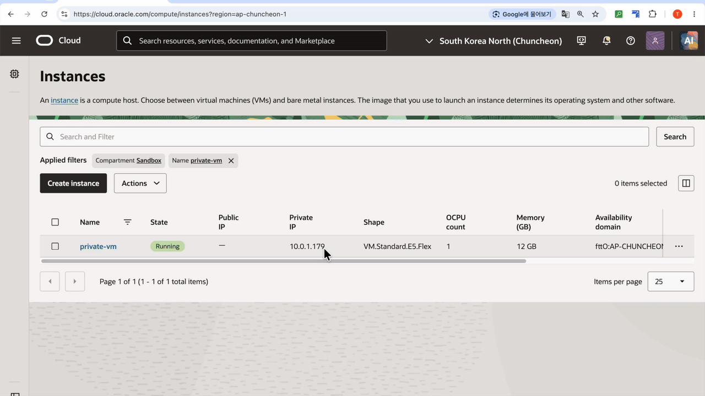
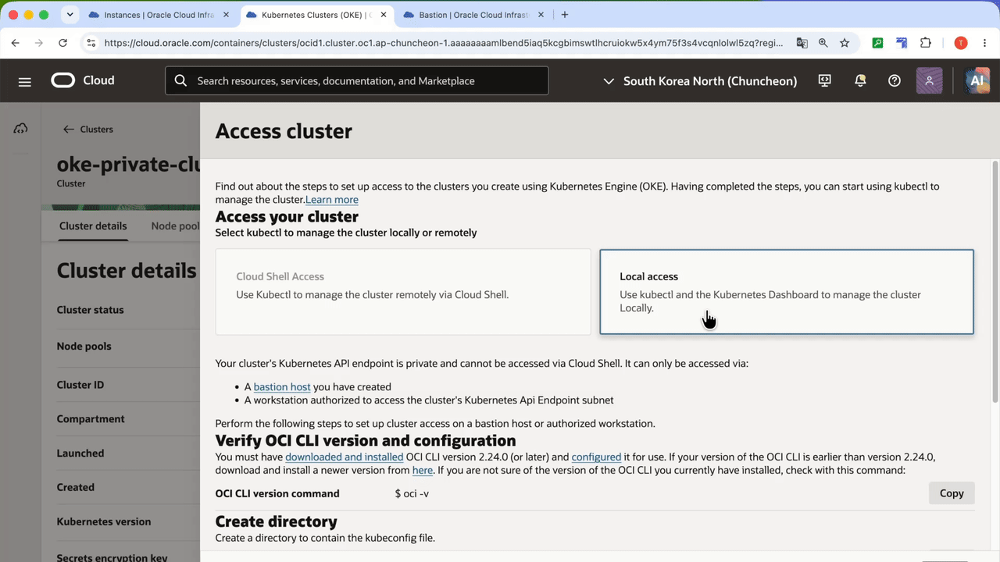
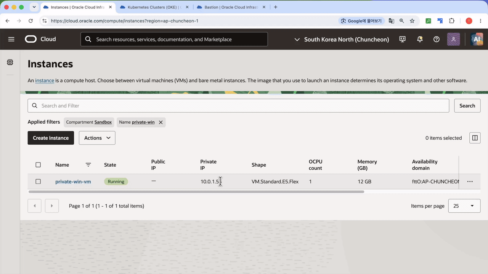

# OCI Bastion Proxy

[](https://github.com/TheKoguryo/oci-bastion-proxy/blob/master/README.md)
[](https://github.com/TheKoguryo/oci-bastion-proxy/blob/master/README.ko.md)

OCI Bastion을 통해 로컬 SOCKS5 프록시를 실행하는 Bash 스크립트입니다. 리전을 선택하면 Dynamic Port Forwarding 세션을 재사용하거나 새로 생성하고, 현재 터미널에서 SSH 터널을 실행합니다.

OCI CLI가 설치·구성되어 있으면 사용할 수 있으며, 생성된 SSH 명령을 복사해 붙여 넣는 과정도 필요하지 않습니다.

```text
브라우저 / SSH / kubectl
         │
         ▼
SOCKS5 프록시: 127.0.0.1:1080
         │
         ▼
선택한 리전의 OCI Bastion
         │
         ▼
사설 네트워크의 서비스
```

## 주요 기능

- Dynamic Port Forwarding(SOCKS5)을 통한 다양한 사설 주소와 포트 연결
- 실행할 때 사용할 리전을 선택하는 대화형 메뉴: 한 번에 한 리전 사용
- 공개키가 일치하는 활성 Dynamic Port Forwarding 세션이 있으면 재사용
- 재사용할 세션이 없으면 자동으로 새로 생성
- 호스트 확인과 키 암호 입력을 포함한 SSH 터널 직접 실행
- `--print-only` 옵션으로 SSH 실행 없이 명령만 출력
- macOS 기본 Bash를 포함한 Bash 3.2 호환

## 사전 준비

- `PATH`에 등록된 Bash, OpenSSH(`ssh`)
- 설치·구성이 완료된 OCI CLI
- OCI Bastion 세션 목록 조회, 상세 조회 및 생성에 필요한 IAM 권한
- 세션 인증에 사용할 OpenSSH 형식의 SSH 키 쌍
- Bastion의 클라이언트 CIDR 허용 목록에 포함된 현재 클라이언트 공인 IP
- Bastion의 사설 엔드포인트에서 대상 서비스의 TCP 포트로 접근할 수 있도록 설정된 네트워크 및 호스트 방화벽 규칙

자세한 내용은 Oracle의 [세션 생성 안내](https://docs.oracle.com/en-us/iaas/Content/Bastion/Tasks/create-session-dynamic-port-forwarding.htm)와 [접속 안내](https://docs.oracle.com/en-us/iaas/Content/Bastion/Tasks/connect-dynamic-port-forwarding.htm)를 참고하세요.

## 빠른 시작

### 1. Bastion 생성

[OCI Console](https://cloud.oracle.com/security/bastion)에서 VCN, Subnet을 지정하여 OCI Bastion을 생성합니다. 

Dynamic Port Forwarding (SOCKS5) Session 세션타입을 사용하기 위해 *Enable FQDN Support and SOCKS5* 꼭 활성화합니다.

Bastion의 클라이언트 CIDR 허용 목록에 포함된 현재 클라이언트 공인 IP를 203.0.113.10/32 형식으로 입력합니다.

테스트를 위해 새 Bastion 세션을 생성하여, Dynamic Port Forwarding (SOCKS5) Session 타입이 선택되는 지 확인합니다.

사용할 SSH Key가 없는 경우, 이때 Generate SSH key pair를 이용해 SSH 키 쌍을 생성하고 키를 다운로드합니다.

Bastion의 OCID를 복사해둡니다.

### 2. 스크립트 설정

[`oci-bastion-proxy.sh`](./oci-bastion-proxy.sh) 상단의 설정 영역을 수정합니다. Region, Bastion OCID와 SSH 키 경로를 자신의 환경에 맞게 지정하세요.

```bash
REGIONS=("ap-chuncheon-1" "ap-seoul-1")
BASTION_OCIDS=(
    "ocid1.bastion.oc1.ap-chuncheon-1.REPLACE_WITH_YOUR_BASTION_ID"
    "ocid1.bastion.oc1.ap-seoul-1.REPLACE_WITH_YOUR_BASTION_ID"
)
PUBLIC_KEY_PATH="$HOME/.ssh/ssh-key-2026-11-19.key.pub"
PRIVATE_KEY_PATH="$HOME/.ssh/ssh-key-2026-11-19.key"
PROFILE_NAME="${OCI_CLI_PROFILE:-DEFAULT}"
SESSION_TTL_SECONDS=10800
LOCAL_PORT=1080
MAX_WAIT_SECONDS=120
```

두 배열은 항목 수와 순서가 같아야 합니다. 각 Bastion OCID는 같은 위치에 있는 리전에 속해야 합니다. 필요한 리전에 맞춰 쌍으로 추가하거나 삭제하세요.

| 설정 | 설명 |
| --- | --- |
| `REGIONS` | 선택 메뉴에 표시할 리전 식별자 |
| `BASTION_OCIDS` | 각 리전에 대응하는 Bastion OCID. 리전 배열과 같은 순서로 지정합니다. |
| `PUBLIC_KEY_PATH` | 새 세션에 등록할 공개키 경로 |
| `PRIVATE_KEY_PATH` | SSH 인증에 사용할 대응하는 개인키 경로 |
| `PROFILE_NAME` | `OCI_CLI_PROFILE`이 설정되어 있고 비어 있지 않으면 해당 값, 그렇지 않으면 `DEFAULT` 사용 |
| `SESSION_TTL_SECONDS` | 새 세션의 유효 시간. 기본값은 `10800`초(3시간)이며 이는 최대값임, Bastion에 설정된 최대 시간 이내로 지정 |
| `LOCAL_PORT` | 로컬 SOCKS5 포트. 기본값은 `1080`입니다. |
| `MAX_WAIT_SECONDS` | 세션 활성화 상태를 반복 확인하는 대기 기준. 기본값은 `120`초 |

설정값은 스크립트에 직접 지정합니다. OCI 프로파일만 환경변수를 참조합니다. 예를 들어 미리 구성한 `DEV` 프로파일을 사용하려면 다음과 같이 설정합니다.

```bash
export OCI_CLI_PROFILE=DEV
```

### 3. 프록시 실행

```bash
bash oci-bastion-proxy.sh
```

메뉴에서 리전을 선택합니다.

```text
Select a region:
  1) ap-chuncheon-1
  2) ap-seoul-1
Enter a number (1-2):
```

모든 OCI CLI 요청은 선택한 리전을 명시적으로 사용합니다. 스크립트는 해당 리전의 Bastion에서 활성 `DYNAMIC_PORT_FORWARDING` 세션을 조회하고, 공개키가 일치하는 가장 최근 세션을 재사용합니다. 일치하는 세션이 없으면 새로 생성하고 활성화된 뒤 SSH를 실행합니다.

SSH 호스트 확인이나 키 암호 입력이 요청되면 진행하고, 프록시를 사용하는 동안 터미널을 열어 두세요.

## 접속 예제

브라우저나 애플리케이션의 프록시 유형을 **SOCKS5**, 호스트를 **127.0.0.1**, 포트를 **1080**으로 설정합니다. 접속 대상 URL은 사설 서비스의 URL을 그대로 사용합니다. `1080` 포트는 HTTP 서버가 아니라 SOCKS5 프록시 포트입니다.

아래 예제를 실행하는 동안 별도의 터미널에서 프록시를 계속 실행해 두세요.

### 1. 사설 인스턴스에 SSH 접속

macOS 또는 `-X`, `-x` 옵션을 지원하는 호환 OpenBSD 계열 `nc`를 사용하는 환경의 예제입니다.

```bash
ssh \
  -o 'ProxyCommand=nc -X 5 -x 127.0.0.1:1080 %h %p' \
  -o ConnectTimeout=10 \
  -i "$HOME/.ssh/ssh-key-vm.key" \
  opc@10.0.1.179
```

대상 인스턴스의 SSH 사용자 이름과 개인키를 사용하세요. 이 키는 Bastion 세션 인증에 사용하는 키와 다를 수 있습니다.

매번 옵션을 입력하는 대신 `~/.ssh/config`에 다음 설정을 추가하면 별칭으로 접속할 수 있습니다.

```sshconfig
Host private-vm
    HostName 10.0.1.179
    User opc
    IdentityFile ~/.ssh/ssh-key-vm.key
    ProxyCommand nc -X 5 -x 127.0.0.1:1080 %h %p
    ConnectTimeout 10
```

`Host`에는 원하는 별칭을 지정하고, `HostName`, `User`, `IdentityFile`은 대상 인스턴스에 맞게 수정하세요. 해당 리전의 프록시를 실행한 상태에서 다음과 같이 접속합니다.

```bash
ssh private-vm
```



### 2. 사설 API 엔드포인트를 사용하는 kubectl / OKE 접속

사용할 kubeconfig와 OKE 인증 정보를 먼저 준비합니다. 컨텍스트와 클러스터 이름을 확인하세요.

```bash
kubectl config get-contexts
kubectl config get-clusters
```

`YOUR_CLUSTER_NAME`을 사용할 컨텍스트에 연결된 클러스터 항목 이름으로 바꾸고, 해당 항목에 프록시를 설정합니다. 이어서 대응하는 컨텍스트로 요청을 실행합니다.

```bash
kubectl config set-cluster YOUR_CLUSTER_NAME \
  --proxy-url=socks5://127.0.0.1:1080
kubectl --context YOUR_CONTEXT_NAME get nodes
```

이 설정은 kubeconfig에 저장됩니다. 접속하기 전에 클러스터에 맞는 Bastion 리전을 선택하세요.

자세한 내용은 [kubectl 클러스터 설정 문서](https://kubernetes.io/docs/reference/kubectl/generated/kubectl_config/kubectl_config_set-cluster/)를 참고하세요.



### 3. Private IP를 사용하는 Windows 서버에 RDP 접속

macOS의 Windows App을 사용하는 예제입니다. ncat으로 로컬 포트를 SOCKS5 프록시에 연결한 뒤, Windows App에서 해당 로컬 포트로 접속합니다.

먼저 ncat이 포함된 nmap을 설치합니다.

```bash
brew install nmap
```

Bastion 프록시가 실행 중인 Mac의 다른 터미널에서 다음 명령을 실행합니다. `10.0.1.100`은 Windows 서버의 사설 IP로 바꾸세요. Bastion에서 서버의 TCP `3389` 포트에 접근할 수 있어야 합니다.

```bash
ncat -l 127.0.0.1 3389 --keep-open \
  --sh-exec 'ncat --proxy 127.0.0.1:1080 --proxy-type socks5 10.0.1.100 3389'
```

로컬 127.0.0.1:3389로 들어온 연결을 SOCKS5 프록시를 통해 Windows 서버 10.0.1.100:3389로 전달합니다.

Windows App의 **Add PC**에서 다음과 같이 설정합니다.

- **PC name:** `127.0.0.1:3389`
- **Gateway:** 사용하지 않음
- **계정:** 대상 Windows 서버의 로그인 계정

```text
Windows App → localhost:3389 → ncat → SOCKS5 localhost:1080 → OCI Bastion → Windows 사설 IP:3389
```

Windows App에는 별도의 SOCKS5 설정이 필요하지 않습니다. `3389`는 로컬 중계 포트이며, 사용 중이라면 `13389` 등 다른 포트로 바꿔도 됩니다. 프록시와 ncat 터미널은 접속하는 동안 열어 두고, 종료할 때 각각 `Ctrl+C`를 누르세요.



## 종료, 리전 변경 및 세션 만료

**Ctrl+C**를 누르면 로컬 터널이 종료됩니다. 리전을 바꾸려면 현재 터널을 종료하고 스크립트를 다시 실행한 뒤 다른 리전을 선택하세요. 애플리케이션은 새 연결에서도 동일한 프록시 주소 `127.0.0.1:1080`을 사용할 수 있습니다.

SSH를 종료해도 OCI 세션은 삭제되지 않습니다. 세션은 TTL이 만료되거나 수동으로 삭제할 때까지 유지됩니다. 기존 세션을 재사용해도 TTL은 초기화되지 않으며, `SESSION_TTL_SECONDS` 변경은 새로 생성하는 세션에만 적용됩니다.

세션이 만료되면 터널과 이를 통해 연결된 SSH 등의 연결도 끊깁니다. 스크립트는 세션을 자동으로 갱신하거나 재접속하지 않습니다. 스크립트를 다시 실행하고 애플리케이션에서도 다시 접속하세요. 기존 연결이 새 터널로 이전되지는 않습니다.

## 감사의 말

[mattstief/oci_bastion_session_connector](https://github.com/mattstief/oci_bastion_session_connector)에서 영감을 받아 제작했습니다. 원본의 세션 생성 흐름을 바탕으로 Bash 기반 SOCKS5 프록시 실행, 세션 재사용, 리전 선택 기능을 구현했습니다.

Bash 스크립트와 영문 README는 OpenAI Codex의 도움을 받아 작성했습니다.
