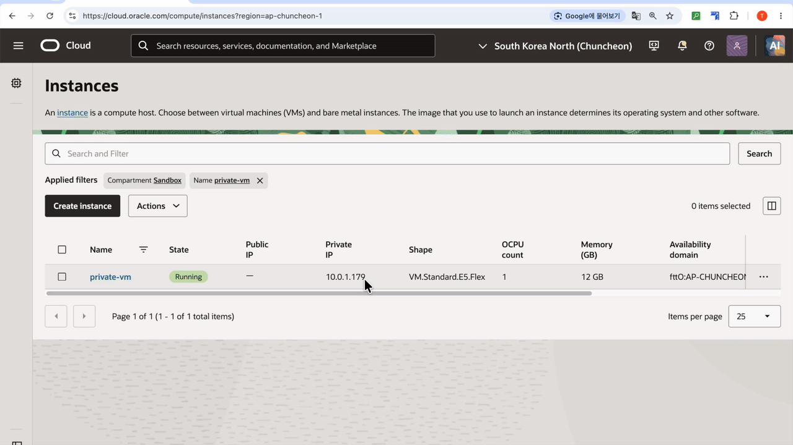
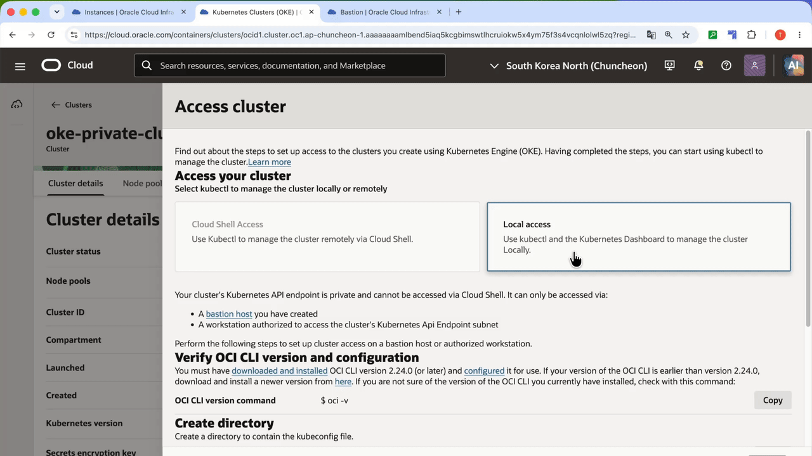
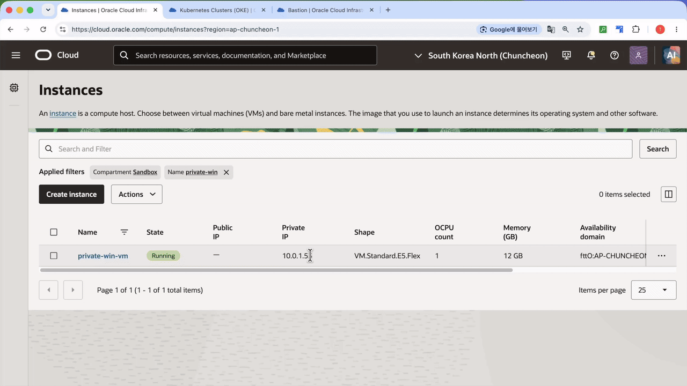

# OCI Bastion Proxy

[](https://github.com/TheKoguryo/oci-bastion-proxy/blob/master/README.md)
[](https://github.com/TheKoguryo/oci-bastion-proxy/blob/master/README.ko.md)

A Bash script that starts a local SOCKS5 proxy through OCI Bastion. Select a region, and the script reuses or creates a Dynamic Port Forwarding session and starts the SSH tunnel in your terminal.

With OCI CLI installed and configured, you can run the script without copying and pasting the generated SSH command.

```text
Browser / SSH / kubectl
         │
         ▼
SOCKS5 proxy: 127.0.0.1:1080
         │
         ▼
OCI Bastion in the selected region
         │
         ▼
Private services
```

## Features

- Dynamic Port Forwarding (SOCKS5) to different private addresses and ports
- Interactive region selection: one region per run
- Reuse of an active Dynamic Port Forwarding session with a matching public key
- Automatic session creation when no matching session exists
- Direct SSH tunnel execution, including host verification and key passphrase prompts
- Command output without starting SSH through `--print-only`
- Bash 3.2 compatibility, including the Bash supplied with macOS

## Prerequisites

- Bash and OpenSSH (`ssh`) on your `PATH`
- OCI CLI installed and configured
- IAM permissions to list, inspect, and create OCI Bastion sessions
- An SSH key pair in OpenSSH format for session authentication
- Your current public IP included in the Bastion's client CIDR allowlist
- Network and host firewall rules allowing the Bastion private endpoint to reach the target service's TCP port

See Oracle's [session creation guide](https://docs.oracle.com/en-us/iaas/Content/Bastion/Tasks/create-session-dynamic-port-forwarding.htm) and [connection guide](https://docs.oracle.com/en-us/iaas/Content/Bastion/Tasks/connect-dynamic-port-forwarding.htm).

## Quick start

### 1. Create a Bastion

Create an OCI Bastion in the [OCI Console](https://cloud.oracle.com/security/bastion), specifying the VCN and subnet.

Enable *Enable FQDN Support and SOCKS5* to use the Dynamic Port Forwarding (SOCKS5) session type.

Add your current public IP to the Bastion's client CIDR allowlist in CIDR notation, such as `203.0.113.10/32`.

Create a test Bastion session to confirm that the Dynamic Port Forwarding (SOCKS5) session type is available.

If you do not have an SSH key pair, use **Generate SSH key pair** at this step and download the keys.

Copy the Bastion OCID for the next step.

### 2. Configure the script

Edit the configuration section at the top of [`oci-bastion-proxy.sh`](./oci-bastion-proxy.sh). Set the regions, Bastion OCIDs, and SSH key paths for your environment.

```bash
REGIONS=("ap-chuncheon-1" "ap-seoul-1")
BASTION_OCIDS=(
    "ocid1.bastion.oc1.ap-chuncheon-1.REPLACE_WITH_YOUR_BASTION_ID"
    "ocid1.bastion.oc1.ap-seoul-1.REPLACE_WITH_YOUR_BASTION_ID"
)
PUBLIC_KEY_PATH="$HOME/.ssh/ssh-key-2026-11-19.key.pub"
PRIVATE_KEY_PATH="$HOME/.ssh/ssh-key-2026-11-19.key"
PROFILE_NAME="${OCI_CLI_PROFILE:-DEFAULT}"
SESSION_TTL_SECONDS=10800
LOCAL_PORT=1080
MAX_WAIT_SECONDS=120
```

The arrays must have the same number of entries in the same order. Each Bastion OCID must belong to the region at the corresponding position. Add or remove region/Bastion pairs as needed.

| Setting | Description |
| --- | --- |
| `REGIONS` | Region identifiers shown in the selection menu. |
| `BASTION_OCIDS` | Corresponding Bastion OCIDs, in the same order as `REGIONS`. |
| `PUBLIC_KEY_PATH` | Public key registered for new sessions. |
| `PRIVATE_KEY_PATH` | Matching private key used by SSH. |
| `PROFILE_NAME` | Uses `OCI_CLI_PROFILE` when set and nonempty; otherwise, `DEFAULT`. |
| `SESSION_TTL_SECONDS` | Lifetime of a new session. Defaults to `10800` seconds (3 hours), the service maximum. Must be within the Bastion's configured maximum. |
| `LOCAL_PORT` | Local SOCKS5 port. Defaults to `1080`. |
| `MAX_WAIT_SECONDS` | Activation polling budget. Defaults to `120` seconds. |

Settings are assigned directly in the script. Only the OCI profile reads an environment variable. For example, to use a configured profile named `DEV`:

```bash
export OCI_CLI_PROFILE=DEV
```

### 3. Start the proxy

```bash
bash oci-bastion-proxy.sh
```

Select a region from the menu:

```text
Select a region:
  1) ap-chuncheon-1
  2) ap-seoul-1
Enter a number (1-2):
```

All OCI CLI requests explicitly use the selected region. The script searches for active `DYNAMIC_PORT_FORWARDING` sessions on that region's Bastion and reuses the newest session with a matching public key. If none matches, it creates a session and waits for activation before starting SSH.

Complete any SSH host verification or key passphrase prompts and keep the terminal open while using the proxy.

## Connection examples

Set your browser or application's proxy type to **SOCKS5**, host to **127.0.0.1**, and port to **1080**. Use the private service's URL as the destination. Port `1080` is a SOCKS5 proxy port, not an HTTP server.

Keep the proxy running in a separate terminal while using the examples below.

### 1. SSH to a private instance

This example is for macOS or a compatible OpenBSD-style `nc` that supports the `-X` and `-x` options.

```bash
ssh \
  -o 'ProxyCommand=nc -X 5 -x 127.0.0.1:1080 %h %p' \
  -o ConnectTimeout=10 \
  -i "$HOME/.ssh/ssh-key-vm.key" \
  opc@10.0.1.179
```

Use the target instance's SSH username and private key. This key can differ from the one used to authenticate the Bastion session.

To connect using an alias instead of entering these options each time, add the following to `~/.ssh/config`:

```sshconfig
Host private-vm
    HostName 10.0.1.179
    User opc
    IdentityFile ~/.ssh/ssh-key-vm.key
    ProxyCommand nc -X 5 -x 127.0.0.1:1080 %h %p
    ConnectTimeout 10
```

Choose an alias for `Host` and update `HostName`, `User`, and `IdentityFile` for your target instance. With the proxy running in the appropriate region, connect using:

```bash
ssh private-vm
```



### 2. kubectl / OKE with a private API endpoint

Prepare your kubeconfig and OKE credentials. List the contexts and cluster names:

```bash
kubectl config get-contexts
kubectl config get-clusters
```

Replace `YOUR_CLUSTER_NAME` with the cluster entry used by your desired context and configure its proxy. Then send a request using the corresponding context:

```bash
kubectl config set-cluster YOUR_CLUSTER_NAME \
  --proxy-url=socks5://127.0.0.1:1080
kubectl --context YOUR_CONTEXT_NAME get nodes
```

This setting is saved in kubeconfig. Select the Bastion region that matches the cluster before connecting.

See the [kubectl cluster configuration reference](https://kubernetes.io/docs/reference/kubectl/generated/kubectl_config/kubectl_config_set-cluster/) for details.



### 3. RDP to a Windows server with a private IP

This example uses Windows App on macOS. Ncat connects a local port to the SOCKS5 proxy, and Windows App connects to that local port.

First, install Nmap, which includes Ncat:

```bash
brew install nmap
```

With the Bastion proxy running, execute the following in another terminal on the same Mac. Replace `10.0.1.100` with the Windows server's private IP. The Bastion must be able to reach TCP port `3389` on the server.

```bash
ncat -l 127.0.0.1 3389 --keep-open \
  --sh-exec 'ncat --proxy 127.0.0.1:1080 --proxy-type socks5 10.0.1.100 3389'
```

This forwards connections received at local address `127.0.0.1:3389` through the SOCKS5 proxy to the Windows server at `10.0.1.100:3389`.

In Windows App, select **Add PC** and configure:

- **PC name:** `127.0.0.1:3389`
- **Gateway:** None
- **Account:** The target Windows server's login credentials

```text
Windows App → localhost:3389 → Ncat → SOCKS5 localhost:1080 → OCI Bastion → Windows private IP:3389
```

No SOCKS5 configuration is required in Windows App. Port `3389` is the local relay port; if it is already in use, choose another port such as `13389`. Keep both the proxy and Ncat terminals open during the connection. Press `Ctrl+C` in each terminal to stop them.



## Stopping, switching regions, and expiration

Press **Ctrl+C** to stop the local tunnel. To switch regions, stop the current tunnel, run the script again, and select another region. Applications can use the same `127.0.0.1:1080` proxy address for new connections.

Stopping SSH does not delete the OCI session. It remains until its TTL expires or it is manually deleted. Reusing a session does not reset the TTL, and changes to `SESSION_TTL_SECONDS` apply only to newly created sessions.

When a session expires, the tunnel and connections passing through it, including SSH connections, are interrupted. The script does not automatically renew sessions or reconnect. Run the script again and reconnect your applications. Existing connections do not transfer to the new tunnel.

## Acknowledgments

Inspired by [mattstief/oci_bastion_session_connector](https://github.com/mattstief/oci_bastion_session_connector). This project builds on the original session creation workflow to provide a Bash-based SOCKS5 proxy launcher with direct tunnel execution, session reuse, and region selection.

The Bash scripts and English README were written with assistance from OpenAI Codex.
